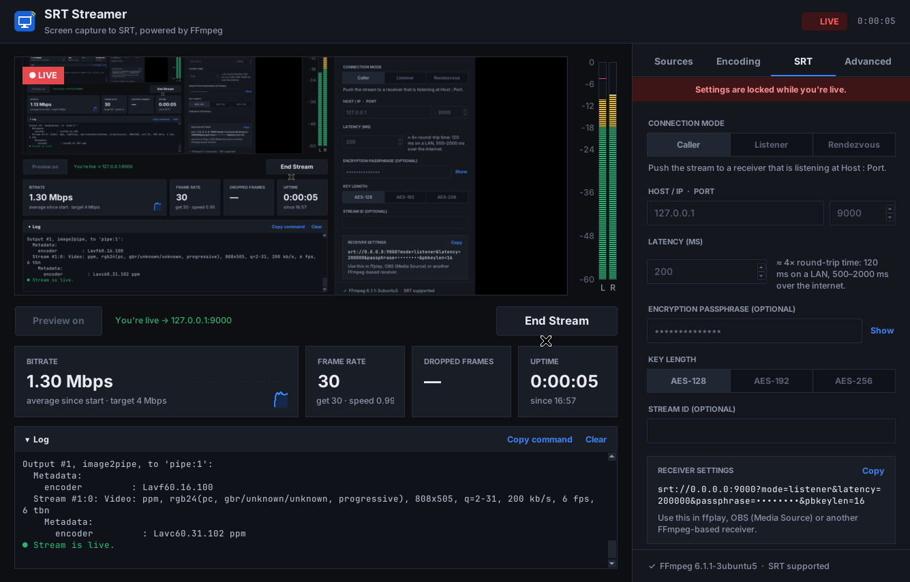

# SRT Streamer

A desktop app that captures a screen or camera plus an audio source with FFmpeg and streams it over SRT, with a live preview, stereo audio meters and stream-health readouts.

## Download (Windows)

Grab `SRT-Streamer-Windows-x64.zip` from the repo's **Releases** page. It's a single `SRT Streamer.exe` with FFmpeg built in. Builds from any branch are also attached to its GitHub Actions run under **Artifacts**.

## Features
- **Live preview** of the source before and while you're live.
- **Stereo peak meters** with peak hold.
- **Stream health:** bitrate graph, frame rate and speed, dropped frames, uptime.
- **Clear status** (Offline / Preview / Connecting / Live / Reconnecting) with automatic reconnect.
- **Computer sound on Windows:** capture what any speaker or headphone output is playing (WASAPI loopback). No Stereo Mix or virtual cable needed.
- **GPU screen capture** (ddagrab) on Windows, which handles monitors with different display scaling. GDI capture is kept as a fallback.
- **Quality presets** and a choice of CPU or graphics-hardware encoders.
- **SRT caller, listener and rendezvous** modes, AES encryption, stream ID.
- **Receiver settings:** a ready-to-copy URL for the receiving end.
- **The exact FFmpeg command** shown and copyable, plus a log drawer with plain-language error hints.

Shortcut: Ctrl+Enter starts or ends the stream.

## Run from source
Requires Python 3.8+ with Tkinter and an FFmpeg build with libsrt.

    python srt_streamer.py

| OS | Video | Audio |
|---|---|---|
| Windows | ddagrab (GPU) per monitor, gdigrab fallback, DirectShow cameras | Computer sound per output (WASAPI loopback), DirectShow mics |
| macOS | avfoundation screens and cameras | avfoundation (mics, BlackHole for system audio) |
| Linux | x11grab per monitor, v4l2 cameras | PulseAudio/PipeWire (`.monitor` = system audio), ALSA |

## Self-test
The app has an end-to-end self-test. It drives the real UI through device discovery, preview (frames and audio meters), going live with encryption to a local SRT receiver, and ending the stream. It then checks that the receiver got H.264 video and AAC audio, and fails on any UI error.

    python srt_streamer.py --self-test out/report.json --capture auto
    "SRT Streamer.exe" --self-test out\report.json --capture gdigrab

`--capture` can be `auto`, `ddagrab`, `gdigrab`, `x11grab`, `avf_video` or `v4l2`. The exit code is 0 when every check passes. A JSON report and screenshots are written next to the report path.

## CI and releases
`.github/workflows/srt-streamer.yml` runs on every change under `srt-streamer/`:
- **Linux:** runs the self-test with x11grab under a virtual display.
- **Windows:**
  - downloads FFmpeg (BtbN GPL build) and checks that it has SRT and ddagrab,
  - self-tests from source,
  - builds the single-file exe with PyInstaller,
  - self-tests **the built exe**, including that it used its bundled FFmpeg,
  - uploads the zip and the test reports and screenshots.
- **Release:** pushing a tag `srt-streamer-vX.Y` (matching `APP_VERSION`) publishes a GitHub release with the zip.

GPU-capture (ddagrab) self-tests run on CI too, but they're allowed to fail: hosted runners have no GPU.

## License
The app is GPL-2.0, like this repo. The Windows build bundles FFmpeg, which is GPL; see `FFMPEG-LICENSE.txt` in the zip.
